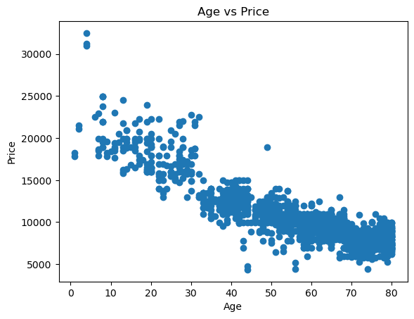

# Toyota Corolla Price Prediction

Multiple linear regression on 1,436 used Toyota Corolla listings to find which car attributes drive resale price and how accurately price can be estimated.

## Problem

A used-car dealer needs a consistent way to value incoming cars. Which attributes (age, mileage, horsepower, weight, fuel type and so on) move the price, and can a simple, explainable model estimate a fair price?

## Data

- **Source:** Toyota Corolla used-car dataset (public teaching dataset, provided as part of the ExcelR Data Science programme)
- **Size:** 1,436 rows, 11 columns, 63 KB (`data/toyota-corolla.csv`)
- **Target:** `Price`
- **Features:** `Age_08_04` (age in months), `KM`, `Fuel_Type`, `HP`, `Automatic`, `cc`, `Doors`, `Cylinders`, `Gears`, `Weight`
- No missing values.

## Approach

1. Inspected structure and summary statistics; renamed `Age_08_04` to `Age` and `cc` to `CC`.
2. Plotted each numeric feature against price (charts in `images/`).
3. One-hot encoded `Fuel_Type` and dropped `Cylinders` (constant value of 4, so no information).
4. Checked correlation of every feature with price.
5. Built three linear regression models on an 80/20 train-test split (`random_state=42`):
   - **Model 1:** all features
   - **Model 2:** removed weakly correlated features (Gears, Doors, fuel type)
   - **Model 3:** Model 2 without KM, to test the effect of removing a feature correlated with Age
6. Interpreted the coefficients of the full model.
7. Compared with Ridge and Lasso regression (alpha = 1.0).

## Key results

Correlation with price: Age −0.88, Weight 0.58, KM −0.57, HP 0.31. Age is by far the strongest driver.

| Model | Features | Test RMSE | Test R² |
|---|---|---|---|
| Model 1 | All | 1,484 | 0.835 |
| **Model 2** | **Weak features removed** | **1,410** | **0.851** |
| Model 3 | Model 2 without KM | 1,488 | 0.834 |
| Ridge (alpha 1.0) | All | 1,483 | 0.835 |
| Lasso (alpha 1.0) | All | 1,482 | 0.835 |

- **Model 2 was the best.** It explains about 85% of the variation in price, with a typical error of about 1,410 in price units.
- **Removing KM (Model 3) made the model worse.** Mileage carries useful information even though it overlaps with age.
- **Ridge and Lasso performed almost the same as plain regression,** so regularisation added little here.
- **Coefficients (Model 1):**
  - Price falls by about 121 for every extra month of age.
  - Price rises by about 26 per extra kg of weight and about 14 per extra unit of horsepower.
  - Price falls by about 16 per extra 1,000 km.



## Business takeaway

- **Age matters most.** A dealer can get a reasonable first price estimate from a few attributes, mainly age, then mileage, weight and horsepower.
- **Typical error is about 1,410.** The model is good enough for a starting price, but a human check is still needed for individual cars.
- **Fewer inputs, same accuracy.** Gears, doors and fuel type add little, so the pricing inputs can be kept short.

## What I learned

- **Fewer features can be better.** Dropping weakly related features improved accuracy on unseen data.
- **Overlapping features can still be useful.** Mileage overlaps with age but still carries its own information, so removing it hurt the model.
- **Regularisation isn't automatic.** Ridge and Lasso don't help when the plain model is already stable, and features should be scaled before using them.
- **What I would do differently:**
  - Fix the one car with `cc` = 16,000 (almost certainly a data-entry error).
  - Measure multicollinearity with VIF; the Age–KM correlation is 0.51.
  - Scale features before Ridge and Lasso.
  - Use cross-validation instead of a single train-test split.

## Tools

Python, pandas, NumPy, Matplotlib, scikit-learn, Jupyter Notebook

## How to run

```bash
git clone https://github.com/manav-atha/toyota-corolla-price-prediction.git
cd toyota-corolla-price-prediction
pip install -r requirements.txt
jupyter notebook notebooks/toyota-corolla-price-prediction.ipynb
```

## Folder structure

```
toyota-corolla-price-prediction/
├── data/
│   └── toyota-corolla.csv
├── images/
│   └── age-, km-, hp-, cc-, weight-vs-price.png
├── notebooks/
│   └── toyota-corolla-price-prediction.ipynb
├── requirements.txt
└── README.md
```
